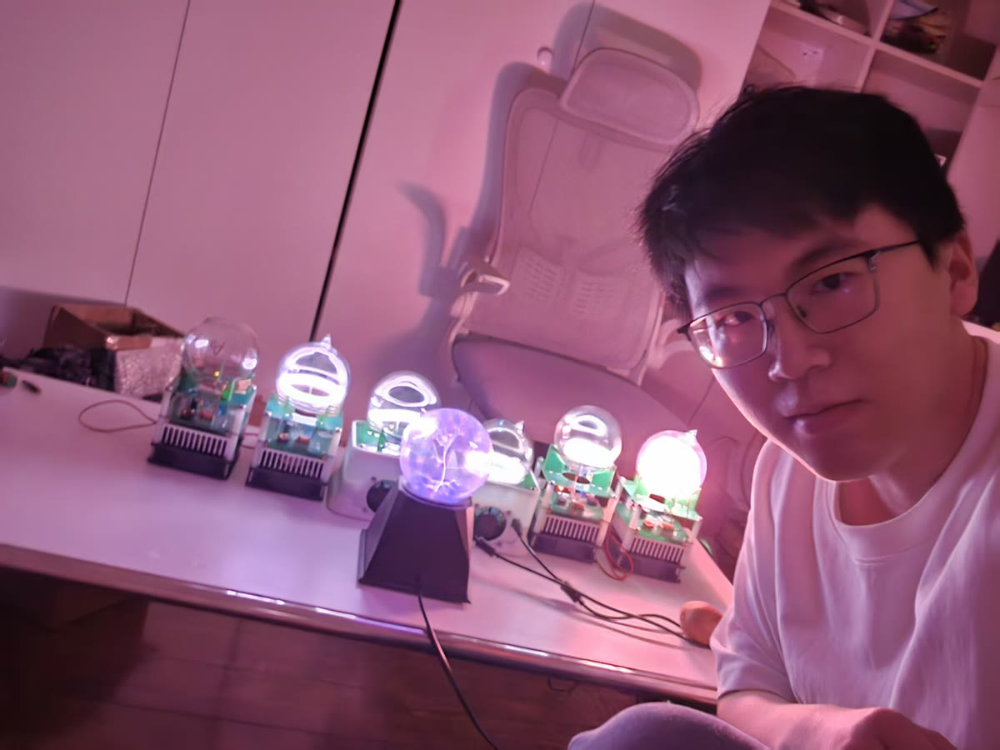
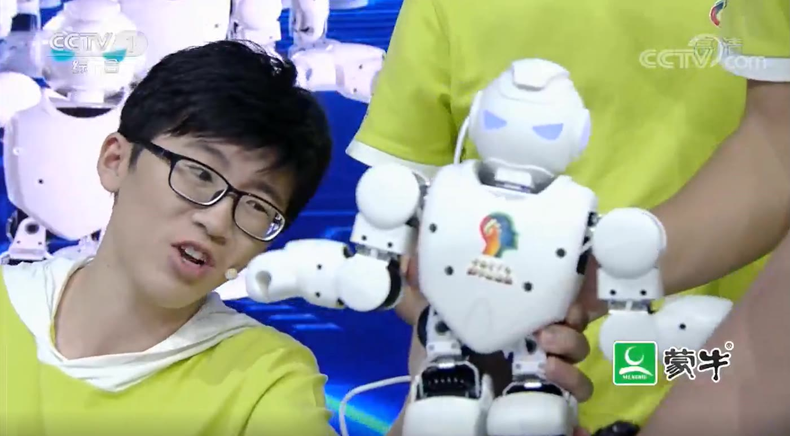

I am **SHANG Zhenyu** (Eric; online as **Skylake**), a PhD student in the Department of Electrical and Electronic Engineering (EEE) at The Hong Kong Polytechnic University and a member of the [Research Centre for Electric Vehicles (RCEV)](https://www.polyu.edu.hk/rcev/), supervised by Dr. WANG Hui and Prof. K.T. Chau. I am also the founder of PhotonJoy Technology Co., Ltd.; our online store, [HaloPlasma](https://haloplasma.com/), is dedicated to plasma toroids and plasma-light devices for makers and enthusiasts.

My research focuses on dynamic wireless charging, wireless motors and transcranial magnetic stimulation. More broadly, I work on power electronics, motor drives, embedded systems and FPGA design — the same threads that run through the projects on this site.

## Research Interests

- Dynamic wireless charging
- Wireless motor
- Transcranial magnetic stimulation
- Power electronics, motor drives, embedded systems and FPGA

## Hardware Experience

I have a lot of project experience from high school and university. The main topic of my work is embedded hardware development and circuit design, which also includes some mechanical design and algorithm research.

I use PSpice/Multisim and Keysight ADS (Advanced Design System) for solution verification, Altium Designer or Cadence for PCB design, SolidWorks for modeling, and a homemade 3D printer for enclosures and structural parts.

I am also very proficient with Cortex-M microcontrollers and Cortex-A embedded chips, including STM32/ESP32 and Rockchip RK3399. In addition, I have some research experience with FPGAs, such as Infineon's PSoC system and Xilinx's Zynq system.

## Software Experience

I have written more than 100,000 lines of code in C/C++, Verilog and Python.

This includes a wide variety of projects, large and small. The main content focuses on embedded systems and FPGAs. There are times when I work on open-source projects or train new neural network models to solve problems around me that need to be automated.

I learned a great deal from Prof. Xinjie Yu's course on circuit principles, and I also studied analog and digital circuits systematically. In terms of circuit analysis, I believe I have solid fundamentals.

## Photos

 

*HaloPlasma plasma toroids, and the championship-winning robot demo on CCTV's 《科学总动员》 in high school.*

## Elsewhere

- [RCEV team members](https://www.polyu.edu.hk/rcev/people/team-members/)
- [HaloPlasma online store](https://haloplasma.com/)
- [CV (PDF)](/file/CV_SHANG_Zhenyu.pdf)

Thank you again for visiting my website.
