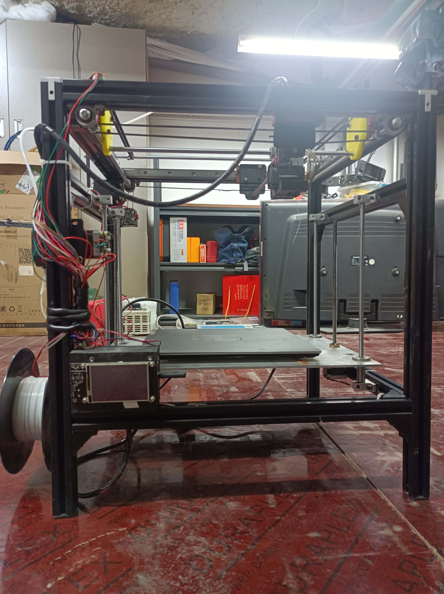
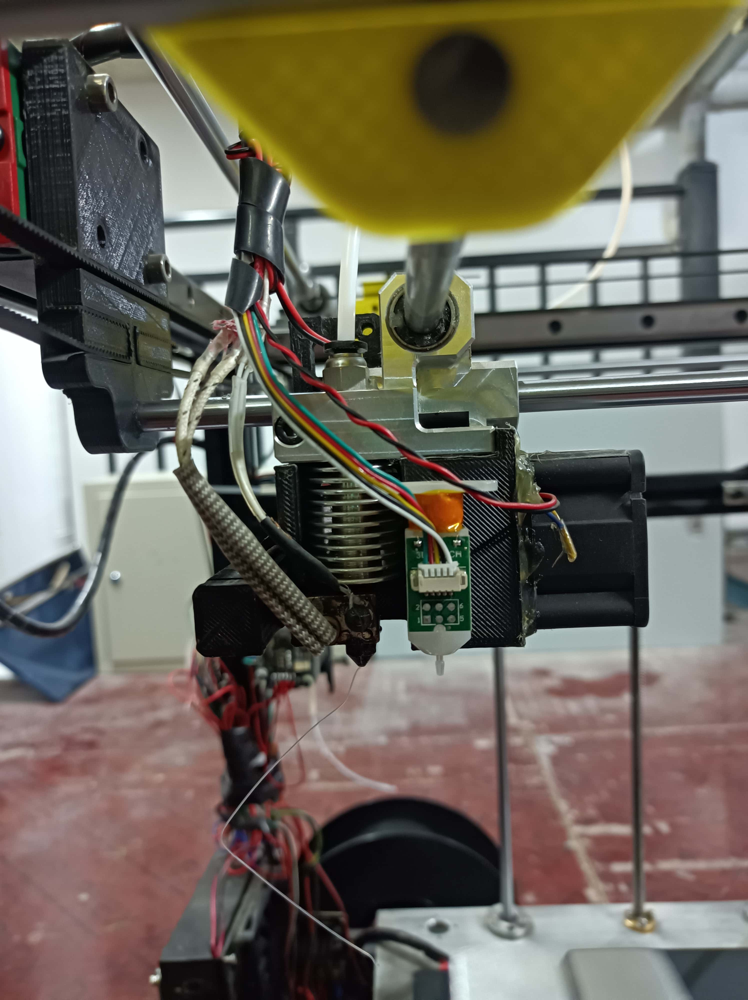
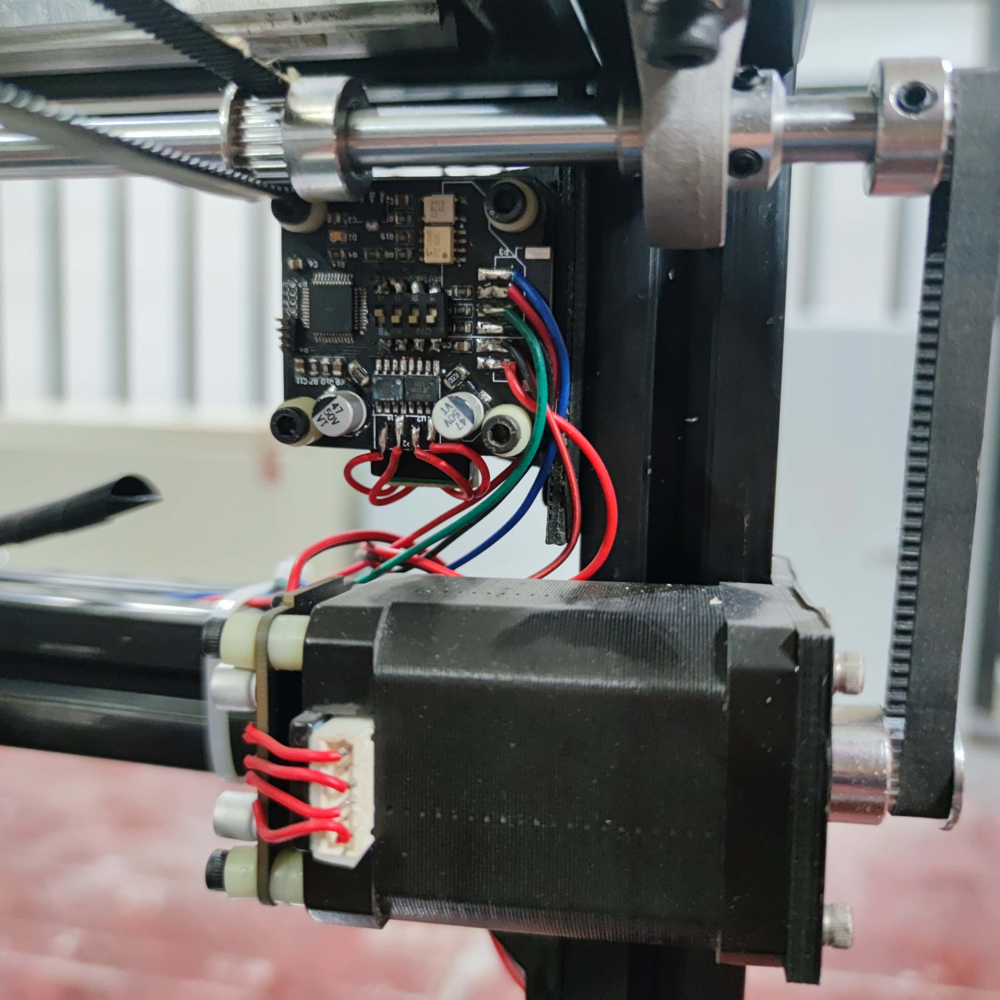
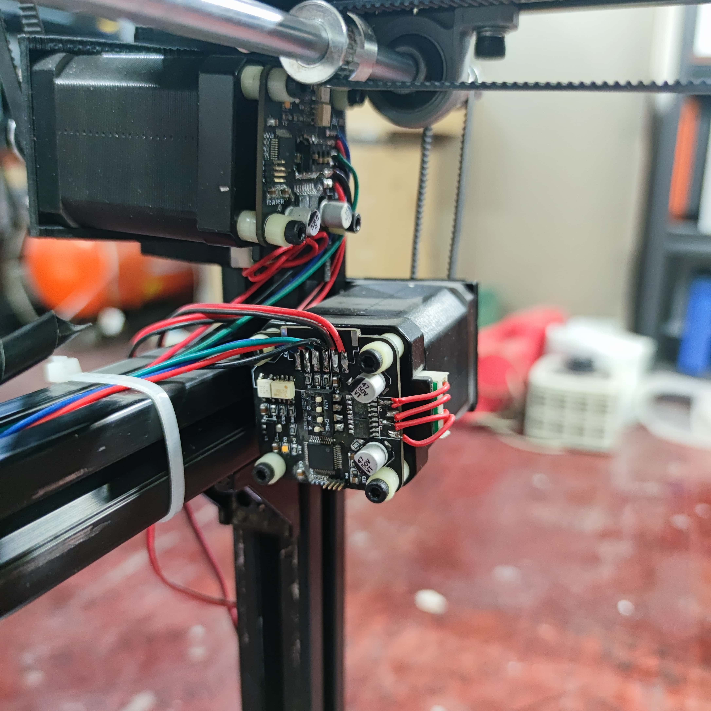

I made a cross shaft driven 3D printer to make device enclosures and some structural assembly parts.

In the beginning, I used a common stepper motor driver, the DRV8825. It is a square wave driver and generates a lot of noise.

So, based on what I had learned, I developed a stepper motor driver using SPWM signal drive. I then added a magnetic encoder, changed the SPWM driver to SVPWM, and added current-loop closed-loop control. The end result was very good vibration control and quietness.

The related devices have been open-sourced on my GitHub.
