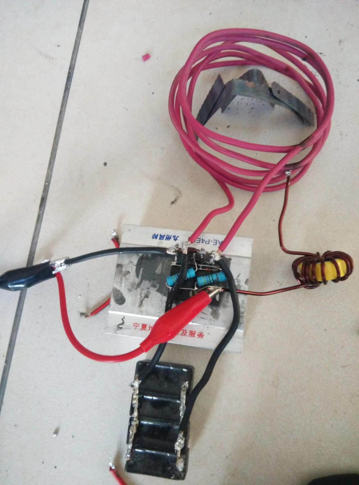
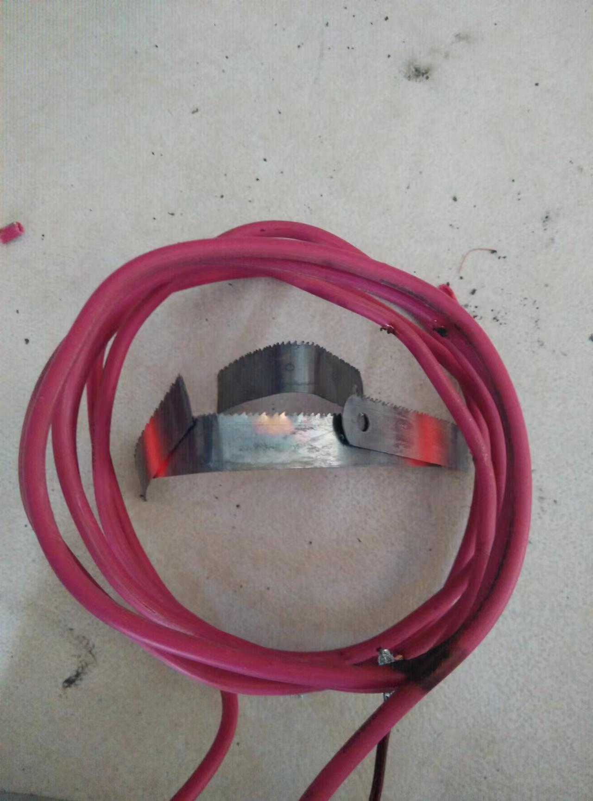
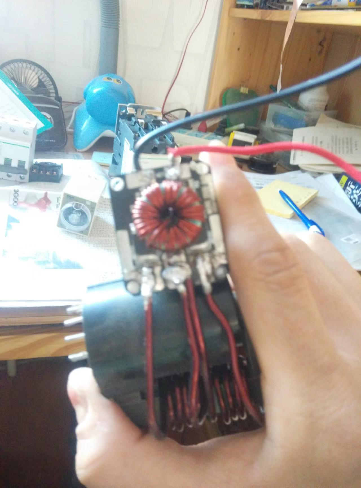
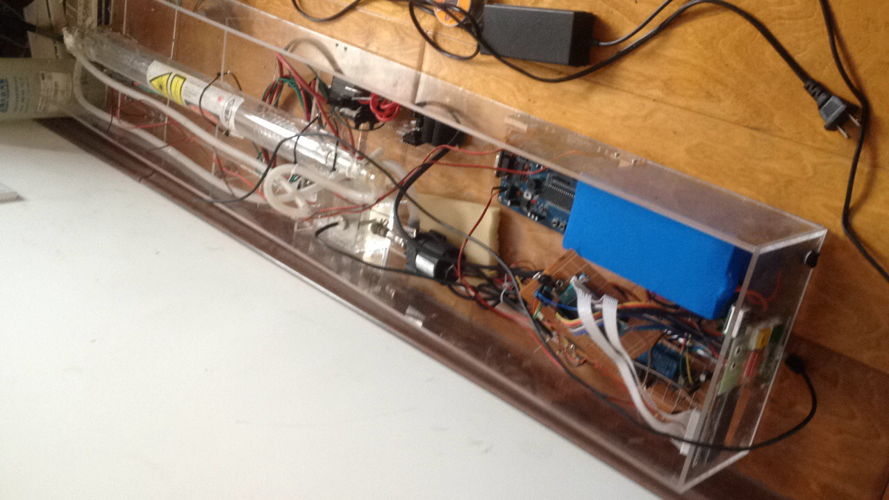
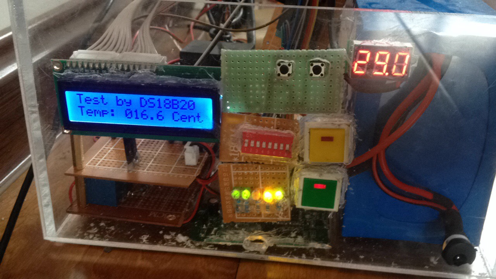
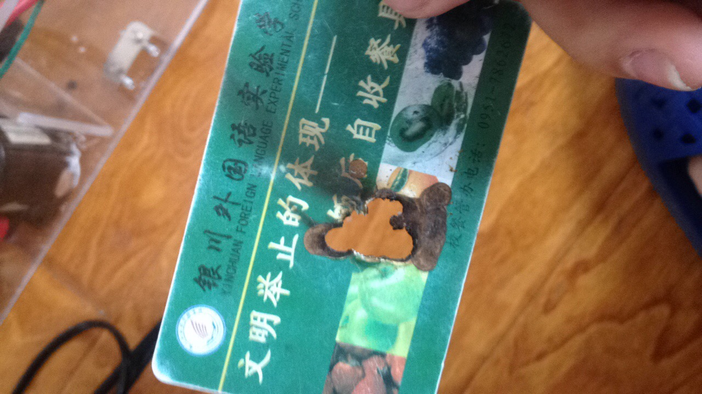

This is another story.

## Beginning

My dad's major is optical processes and manufacturing; he is one of the best engineers in the world.

The word "LASER" was arcane and esoteric.

Until a friend of mine approached me in middle school and said: let's build a LASER gun!

## Progress

After a period of study, we believed that what was within our ability to achieve was a CO2 laser.

### HV Source

It is well known that a conventional CO2 laser pump requires a high-voltage source for excitation. After the gas is broken down, the voltage needs to be reduced and the output current boosted to maintain the breakdown state and produce laser light.

The topology we designed is the classical ZVS. To increase the parallel resonant current, I installed a lot of capacitors.

Here is the result.

I designed the new PCB and put the transformer together.

Finally, I assembled all the devices into a plexiglass box.

To ensure that the water-cooling system works properly, I additionally designed a temperature protection circuit and implemented it with an STC51.

Look at the power test.

