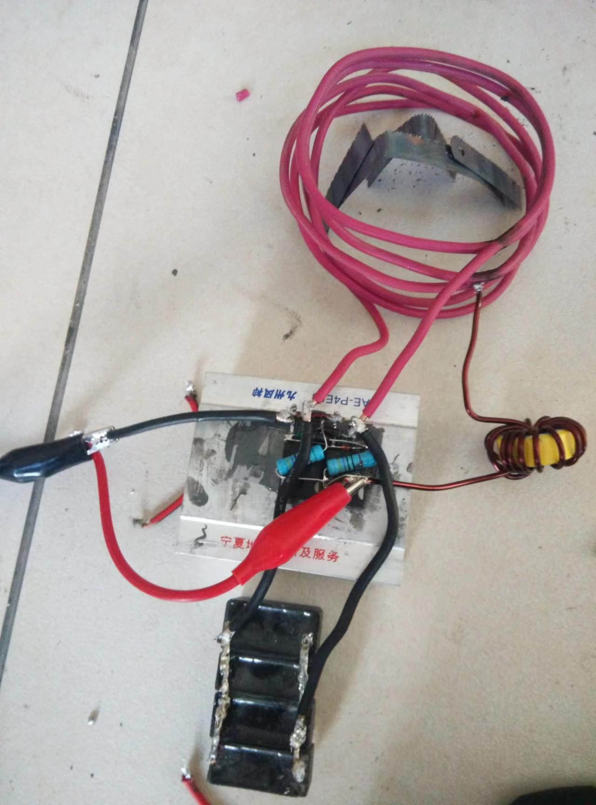
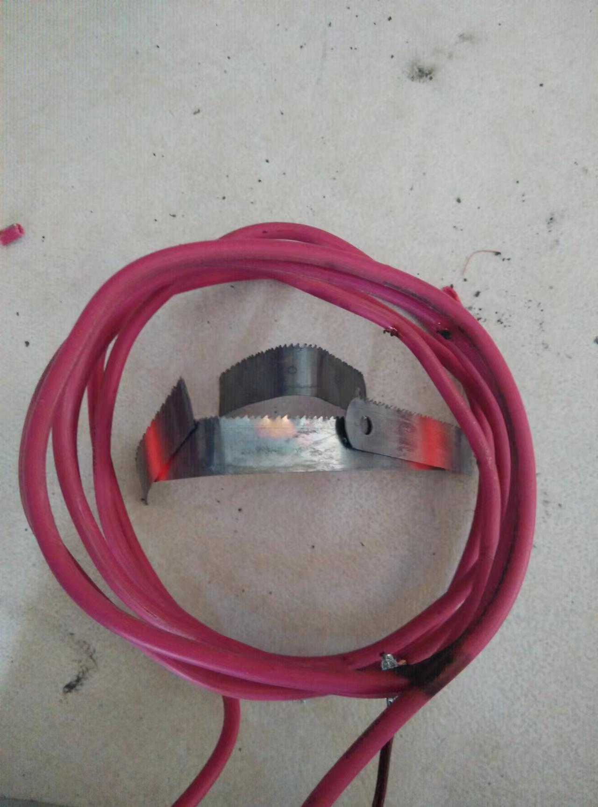
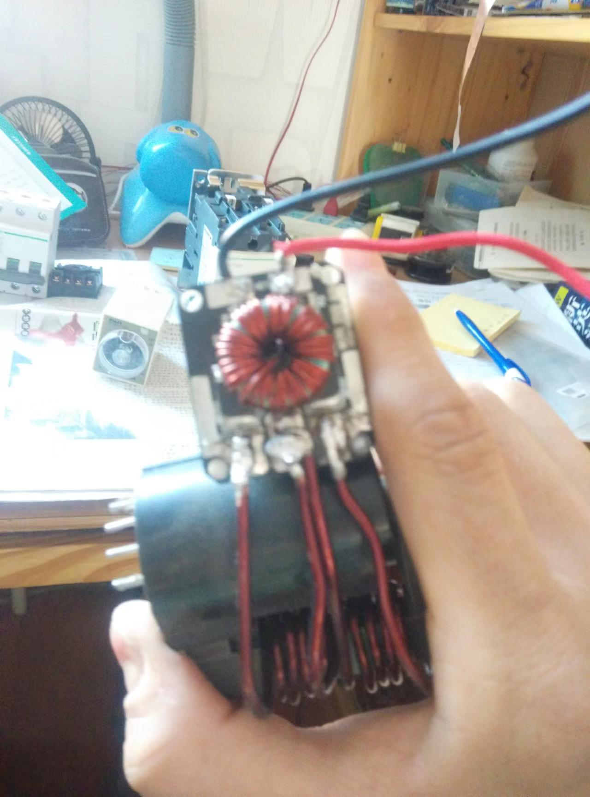
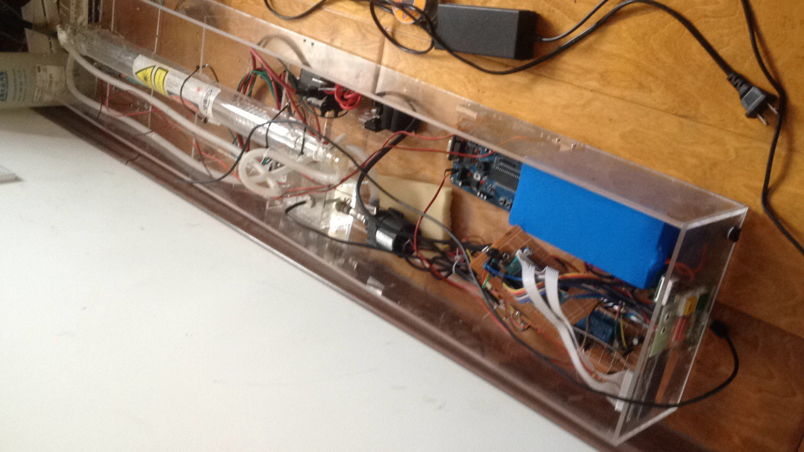
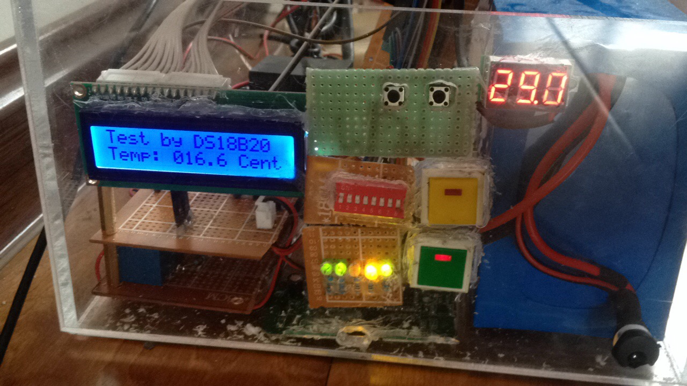
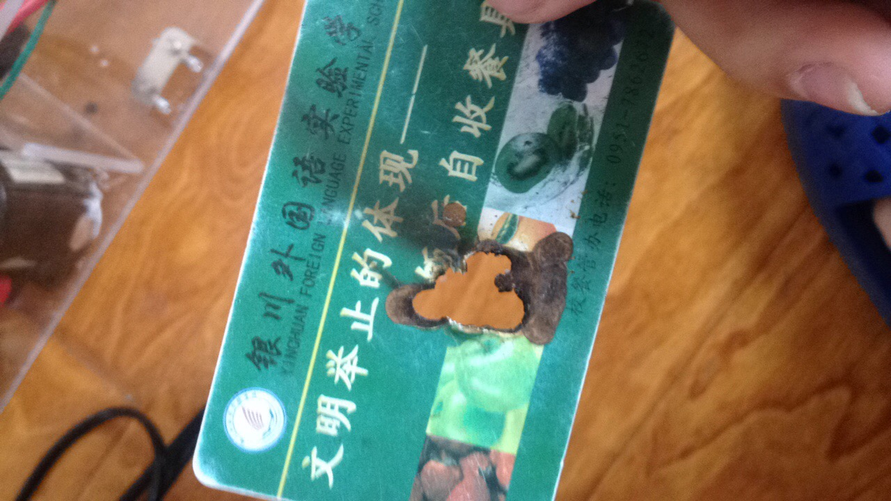

这是另一个故事。

## 起点

父亲的专业是光学工艺与制造，他是世界上最好的工程师之一。

“LASER”这个词，曾对我而言晦涩而神秘。

直到初中时，一位朋友找到我说：我们做一把激光枪吧！

## 进展

经过一段时间的学习，我们相信，在能力范围内可以实现的是 CO2 激光器。

### 高压源

众所周知，传统的 CO2 激光泵浦需要高压源激励。气体击穿后，需要降低电压并提升输出电流，以维持击穿状态，从而产生激光。

我们设计的拓扑是经典的 ZVS。为了增大并联谐振电流，我装了很多电容。

这是结果。

我设计了新的 PCB，并把变压器装了起来。

最后，我把所有装置装进一个亚克力箱里。

为了确保水冷系统正常工作，我额外设计了一个温度保护电路，并用 STC51 实现。

看看功率测试。

