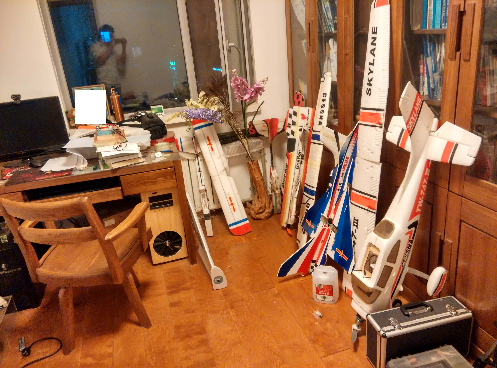
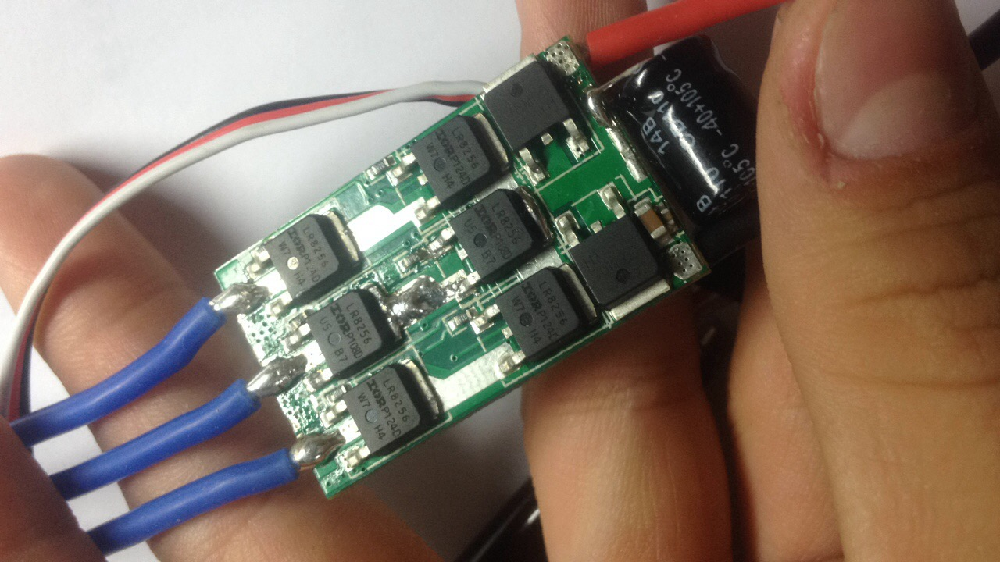
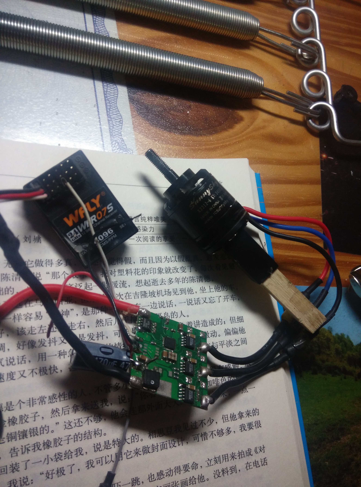
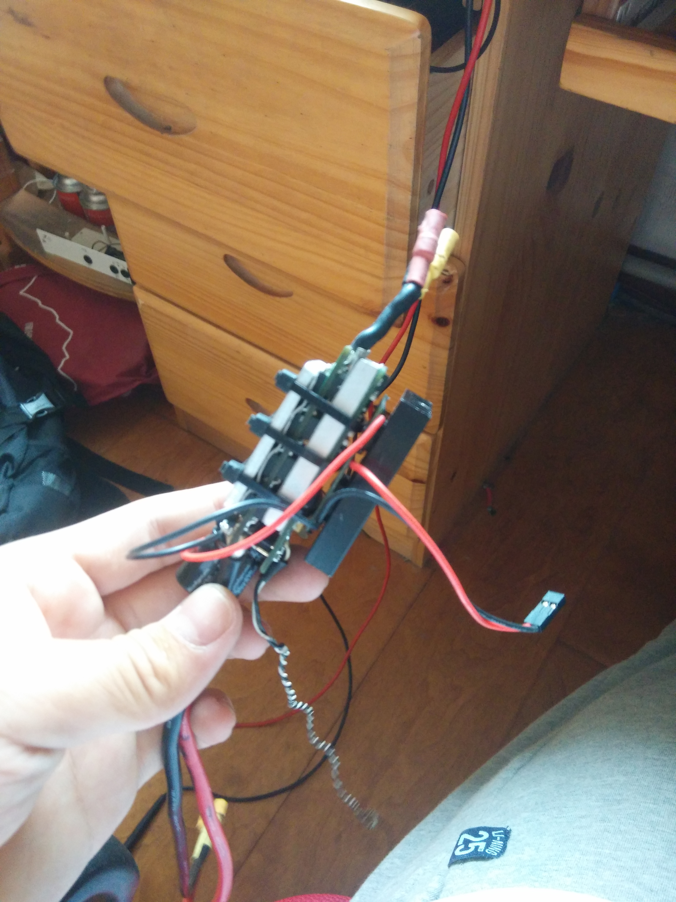
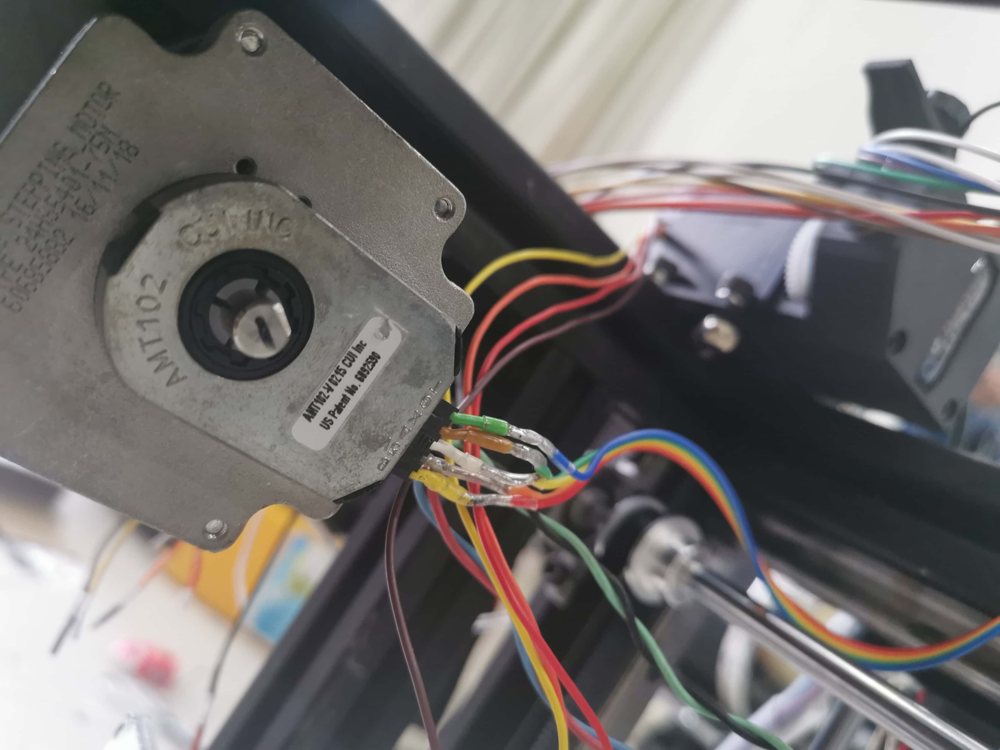
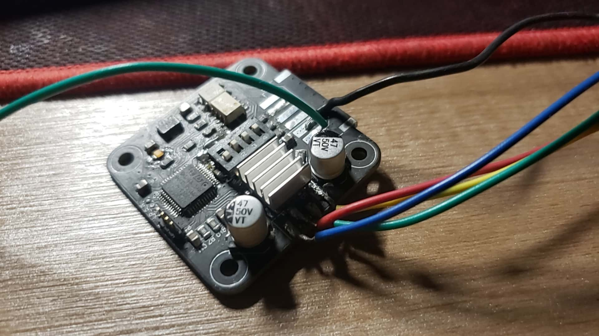
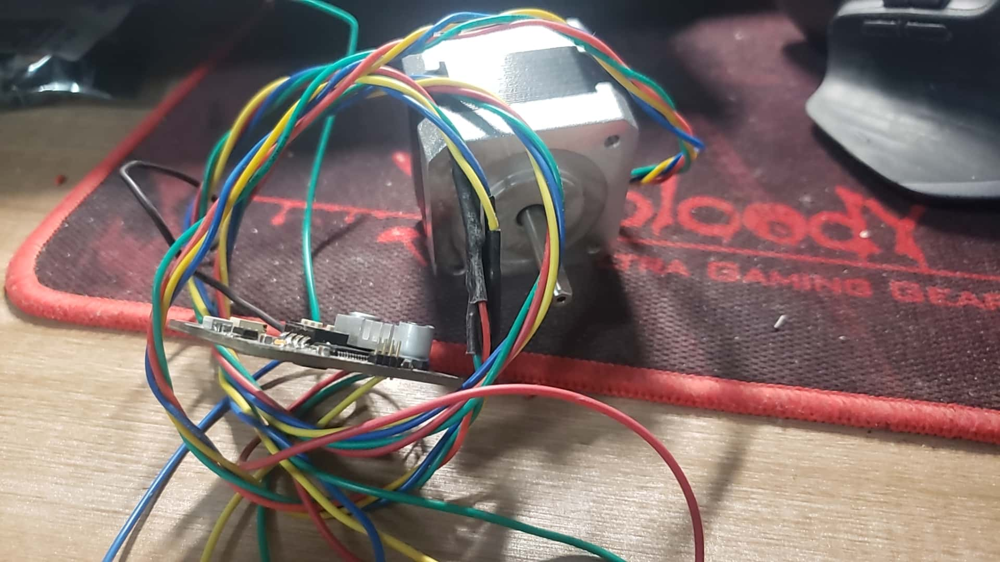
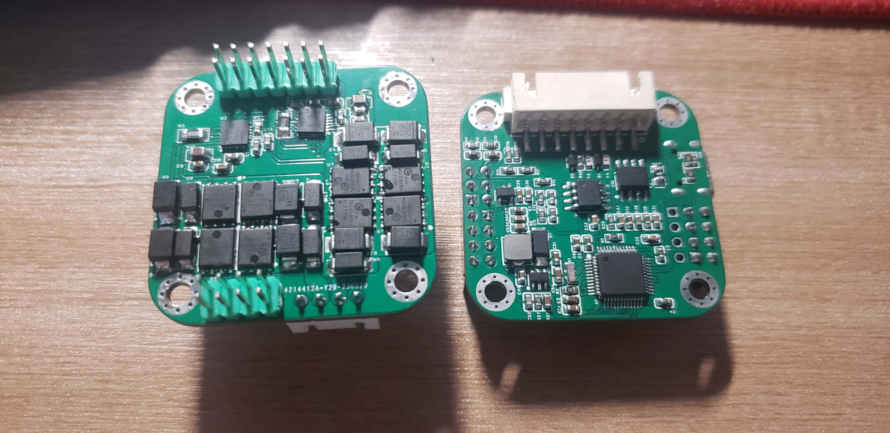

During my middle school years I was introduced to model aviation — a type of aeromodelling powered by electric motors, mainly brushless motors. As my skills grew, I kept trying to make my own brushless motor drivers.

## Beginning

In fact, a BLDC is driven by a simple six-step commutation method. Essentially, a BLDC turns the commutator of a brushed DC motor into electronic switches.

Very quickly, I made my own driver using a microcontroller.

## Development

After that, I discovered the TI C2000 series motor drive function library and PMSM motors. The FOC algorithm can bring infinite possibilities to motor drive.

So I built a motor lab platform: a 57 stepper motor plus an AMT102 optical encoder.

Then MEMS-based magnetic encoders started to roll out in large numbers, and I ported the drive algorithms to an ST microcontroller, swapping the optical encoder for a radial-magnet magnetic encoder. Eventually a small motor driver board was made.

Now, motors based on FOC control run everywhere in my house that needs a motor drive, including my fish tank water pump, computer water pump, air-conditioning inverter compressor, fresh-air fan and so on.

I developed a variety of driver boards to control these motors. Some of them are sensorless, which works under light load.
