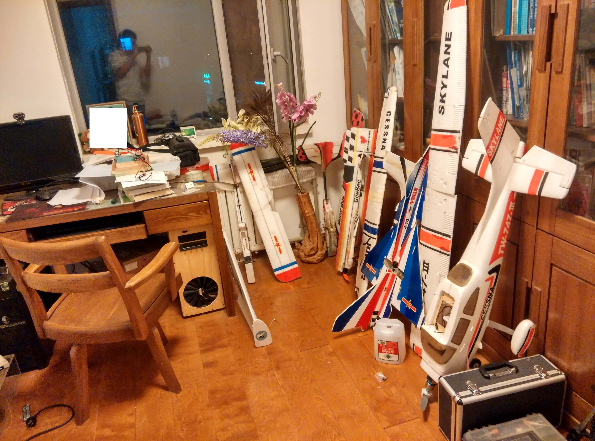
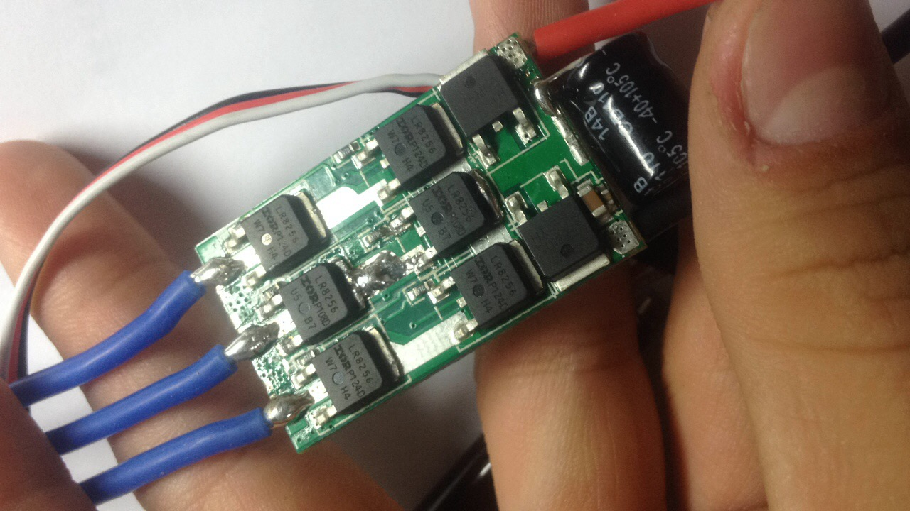
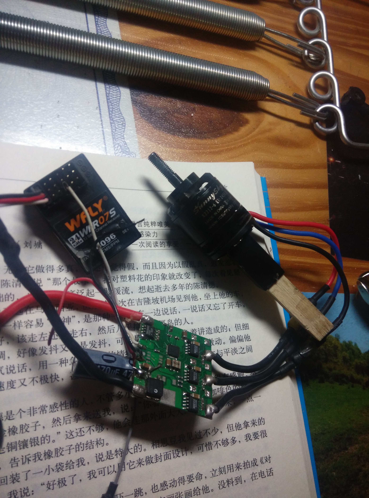
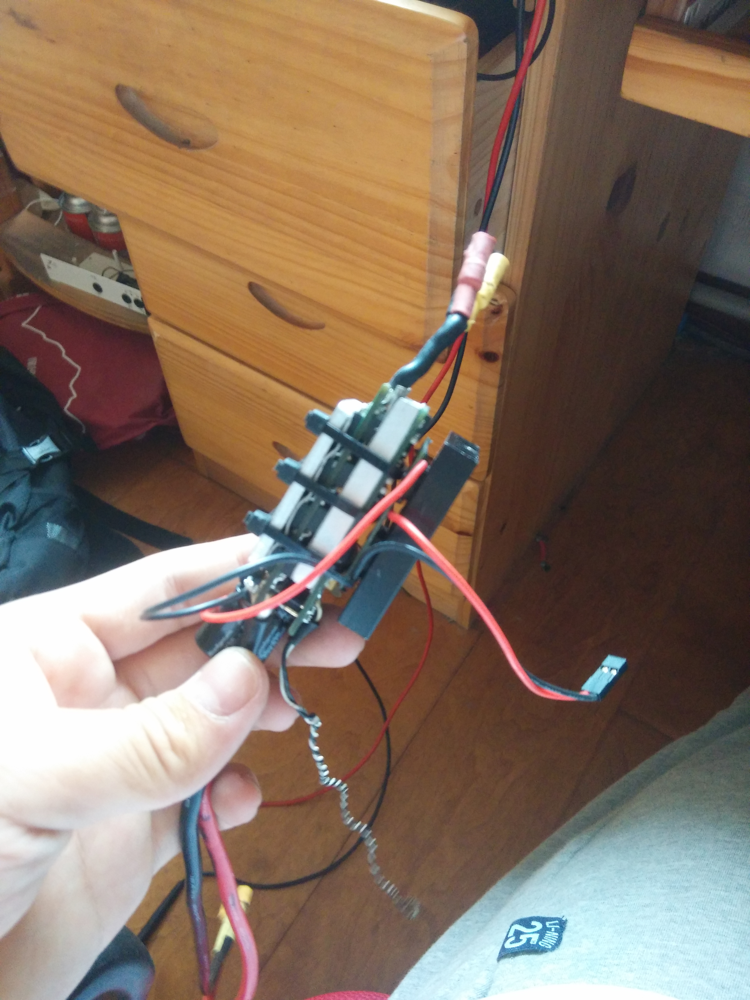
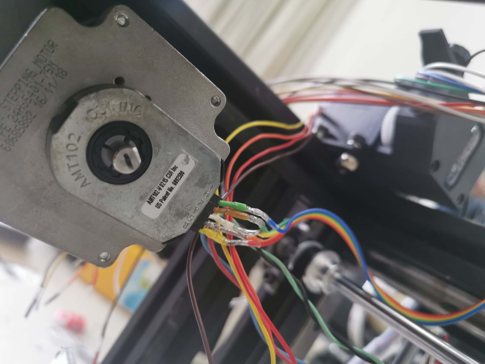
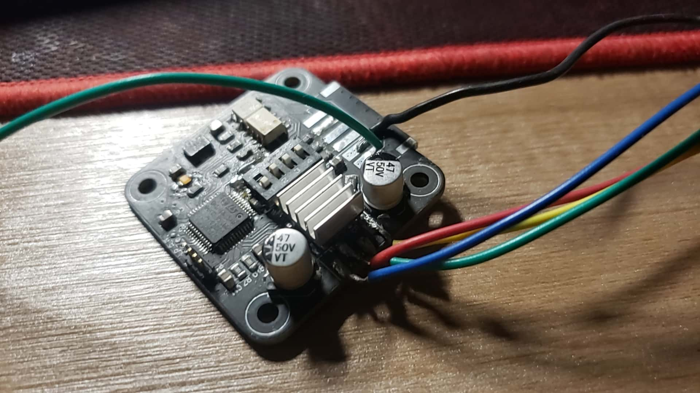
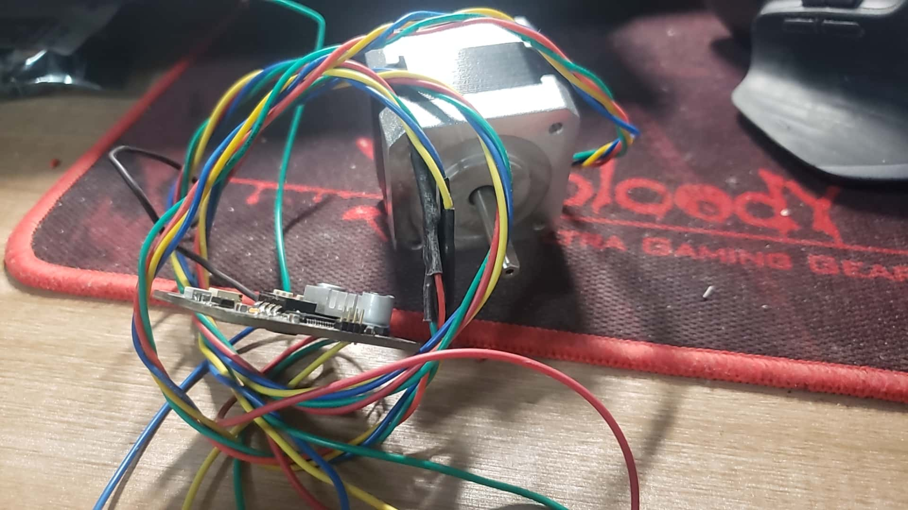
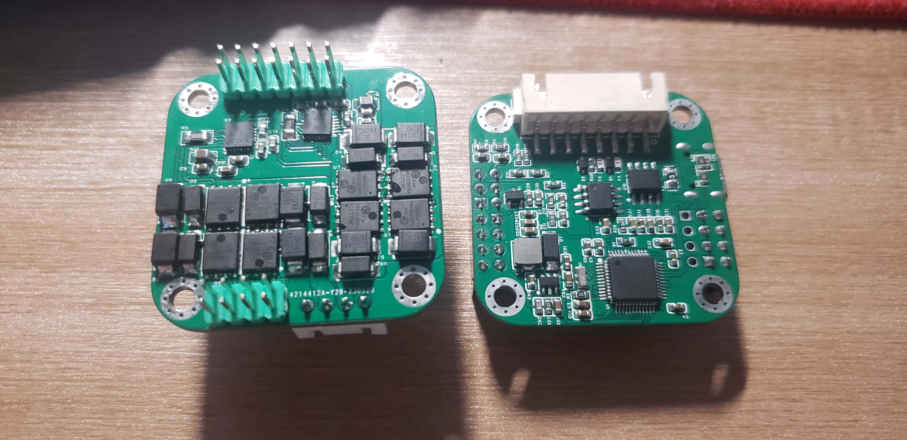

初中时，我接触了航空模型。这是一类由电机（主要是无刷电机）驱动的航模。随着水平提高，我不断尝试自己做无刷电机驱动。

## 起点

实际上，BLDC 的驱动方式是很简单的六步换相。本质上，BLDC 就是把有刷直流电机的换向器变成了电子开关。

很快，我用单片机做出了自己的驱动。

## 发展

之后，我发现了 TI C2000 系列单片机的电机驱动函数库和 PMSM 电机。FOC 算法能为电机驱动带来无限可能。

于是我搭了一个电机实验平台：57 步进电机加 AMT102 光电编码器。

后来，基于 MEMS 的磁编码器开始大量出货。我把驱动算法移植到 ST 单片机，用径向磁化磁铁的磁编码器替换了光电编码器。最终做成了一块小型电机驱动板。

现在，基于 FOC 控制的电机出现在我家所有需要电机驱动的地方，包括鱼缸水泵、电脑水冷泵、空调变频压缩机、新风风扇等等。

我为这些电机开发了各种驱动板。其中一些是无感的，在轻载下也能工作。
