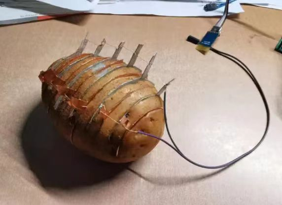
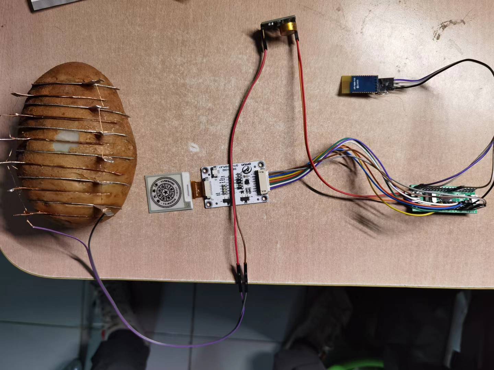
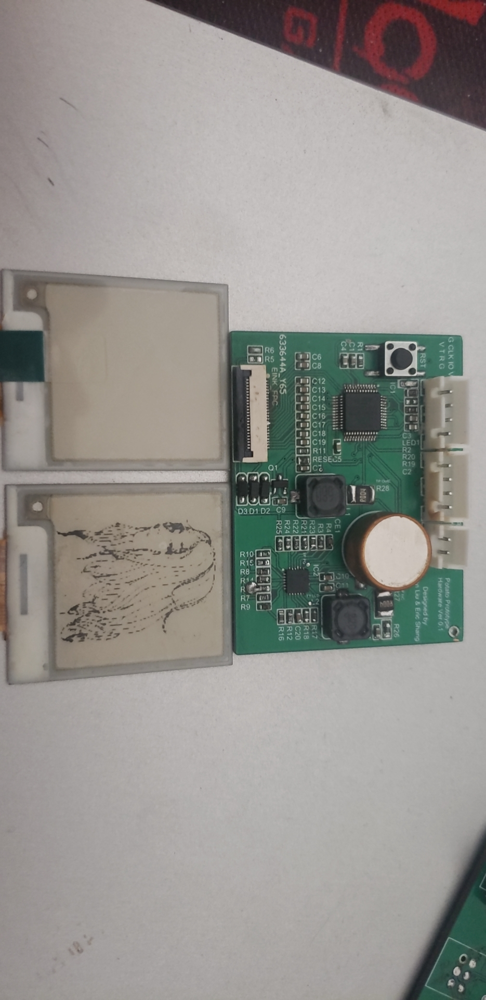
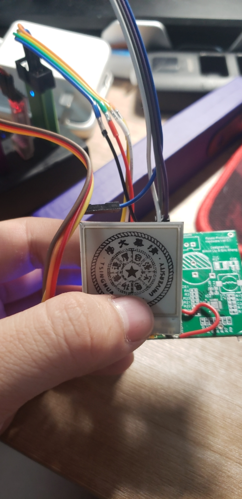

This project comes from a joke that has been circulating on the internet: "Your server is made of potatoes, right?"

My friend and I finished the joke.

First, we need full-power potato batteries.

This is followed by a low-power system including a low-power processor, an E-ink display and a low-power Bluetooth gateway.

Then I designed a PCB for it.

Testing.

This story ended up providing the source of the idea for the 2022 Tsinghua University admissions video.

---


