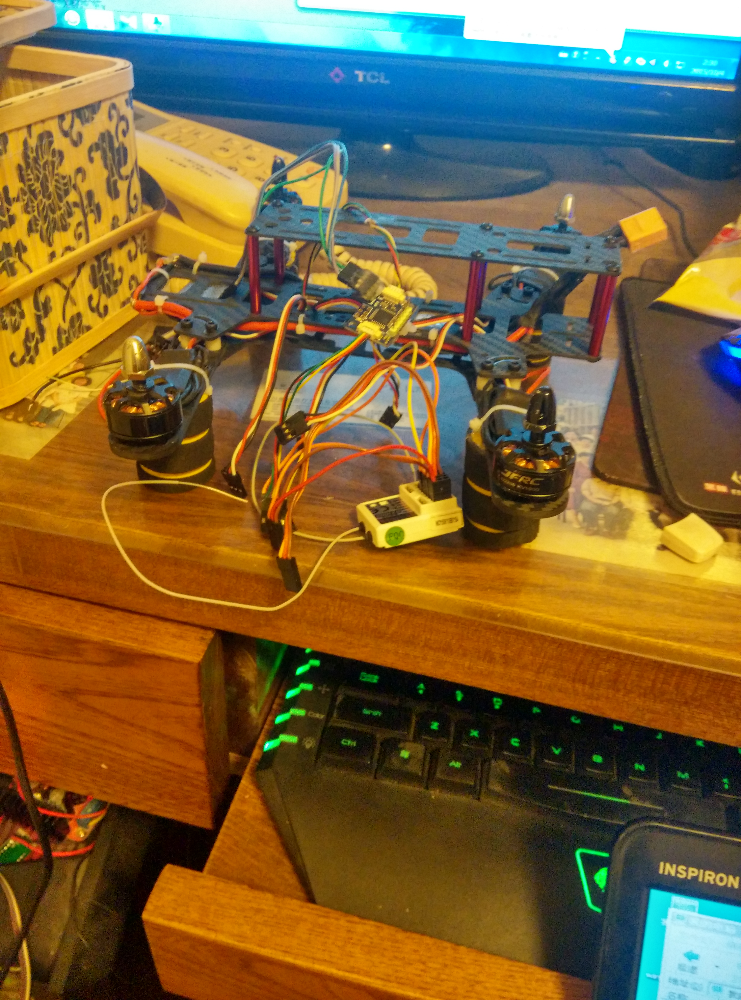
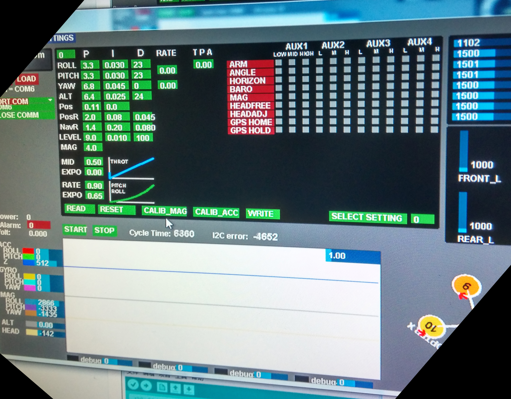
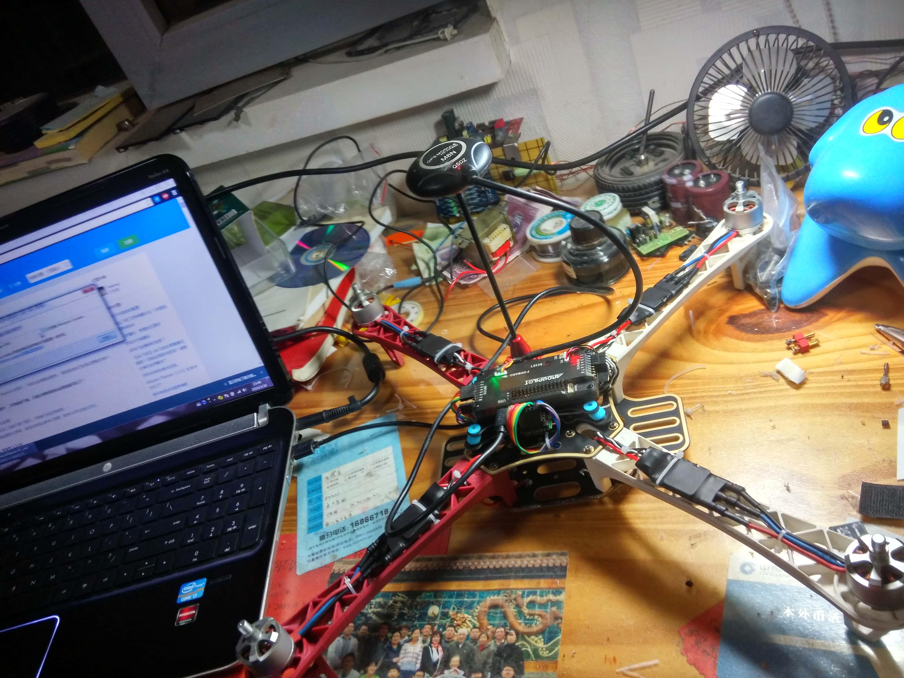
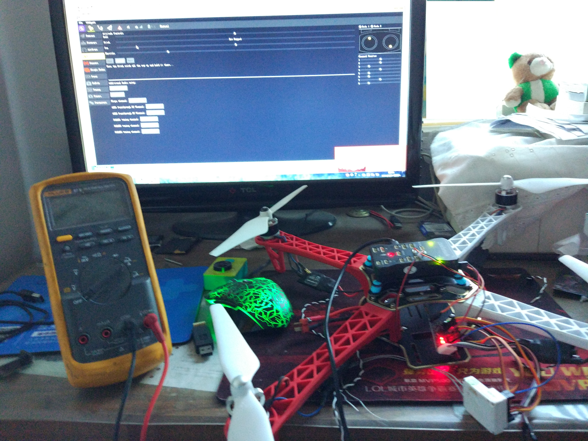
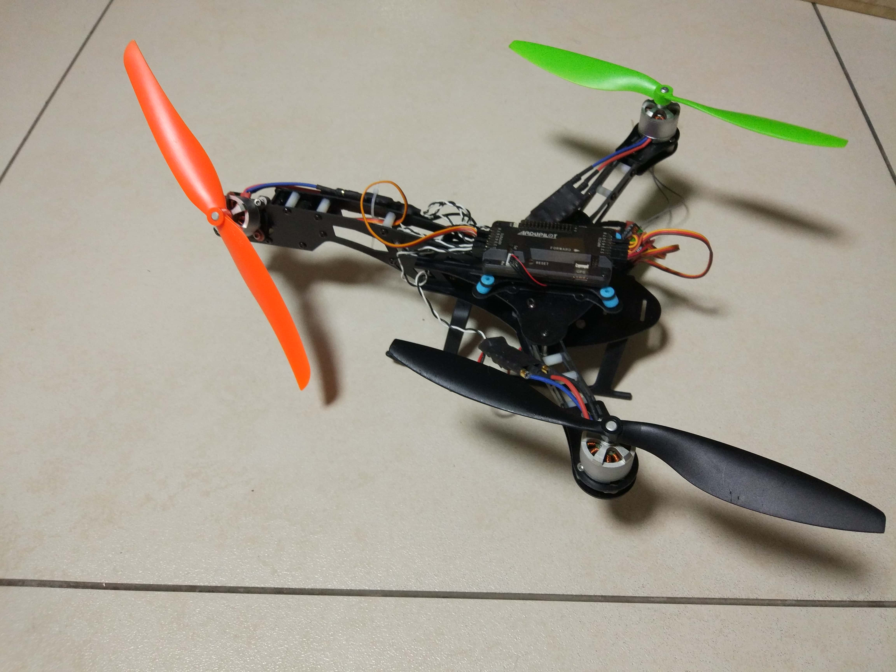
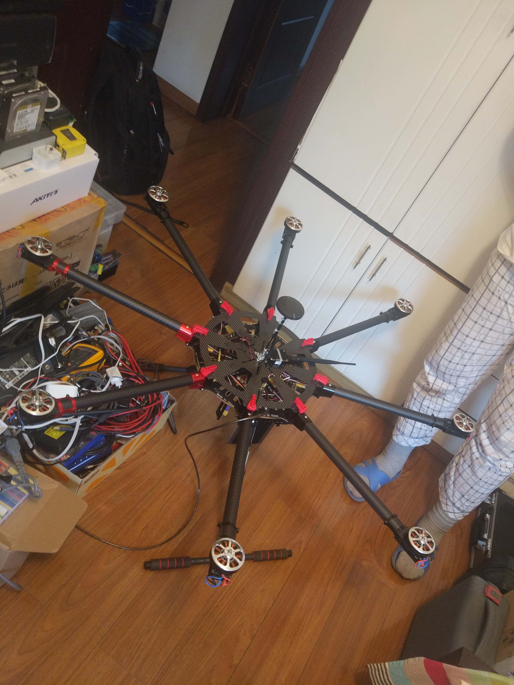
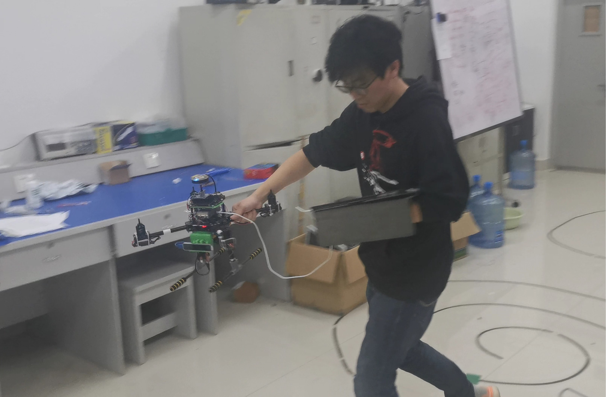
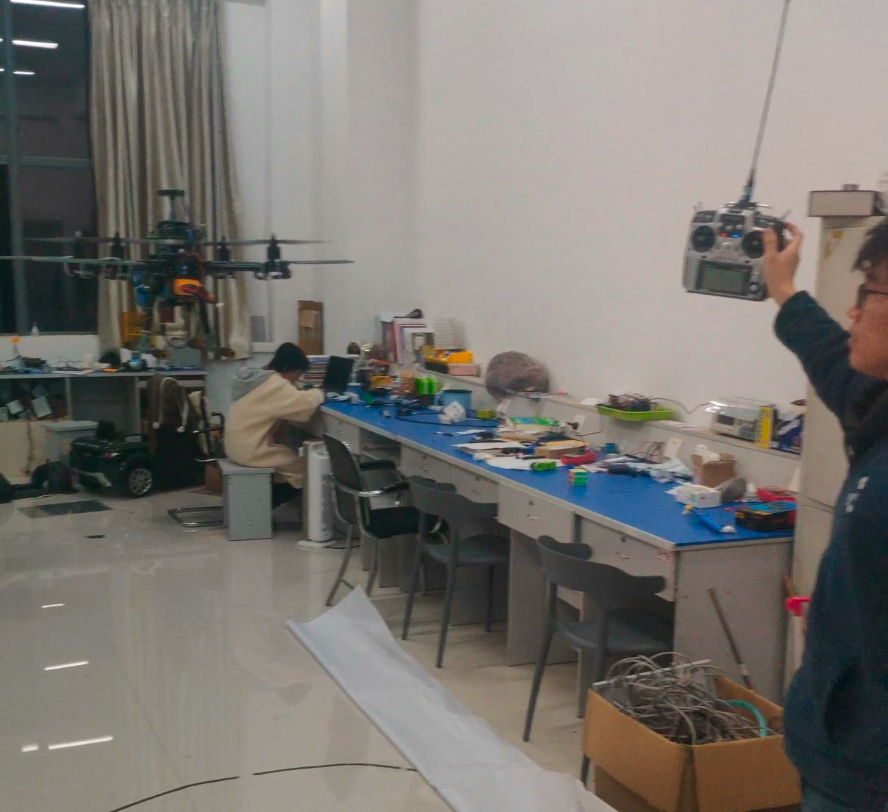
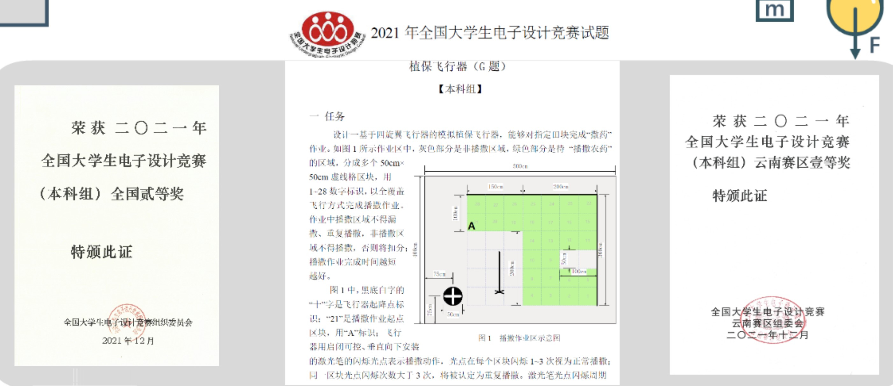

## Beginning

When I was in high school, I was introduced to flight controls and multirotors.

I learned what MultiWii is, and the famous Ardupilot.

I kept thinking about how to get MultiWii's complicated code to run on the Atmel 328p that I could afford at the time.

Followed by Ardupilot running on an Atmega2560. I tuned it all day.

Then there was the revamped Pixhawk 2.4.8.

It also did some weird stuff in between, like the Y3 craft that relies on rudder control of the third-axis tension vector angle to counteract spin.

And the giant eight-axis, with a wheelbase of 1,200 mm.

During my university years, I once again became involved with drones. This time, I won the national second prize of the TI Cup — the highest-level electronics competition for university students — by designing the X4 copter myself.

This project ended up being my final-year project, and it earned the title of outstanding thesis.

