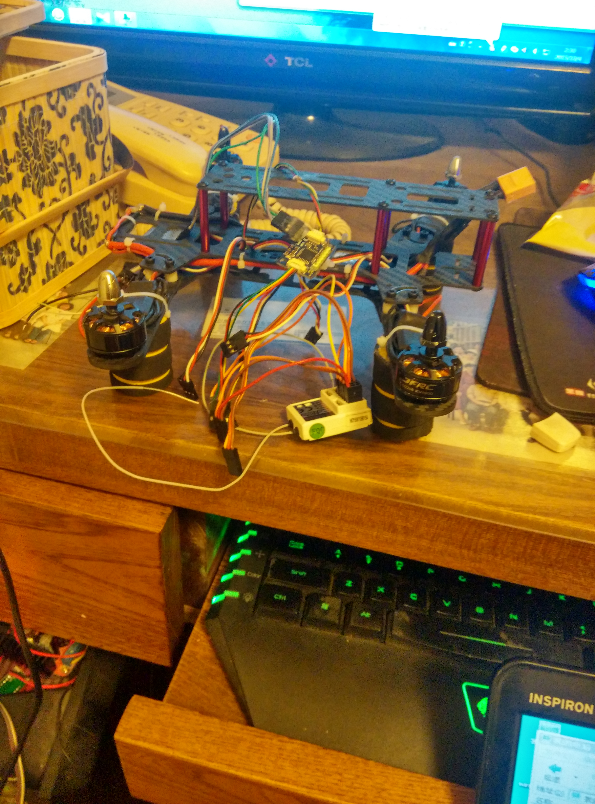
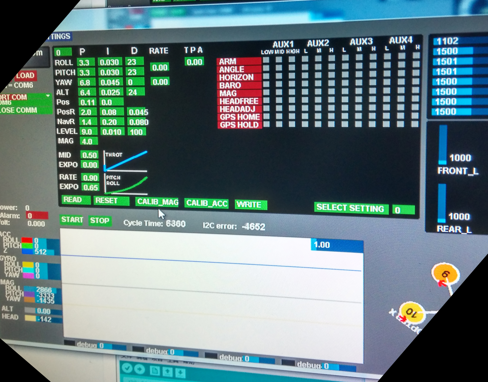
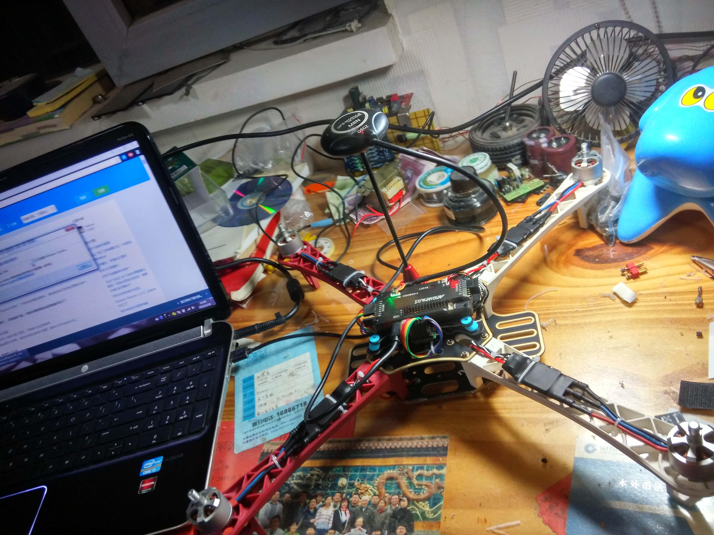
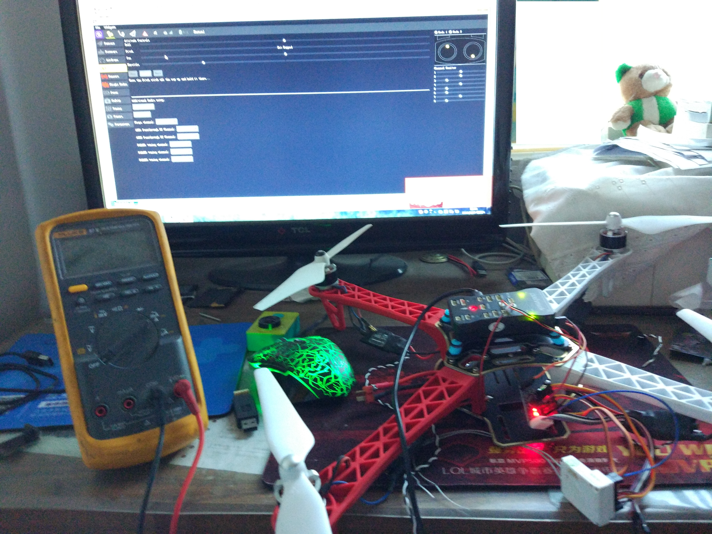
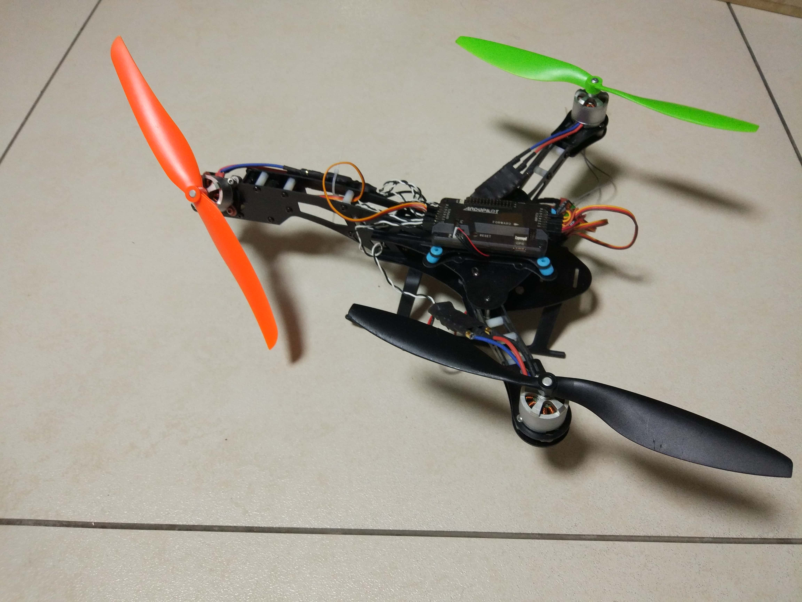
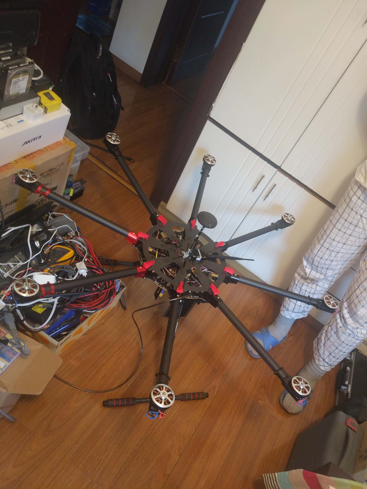
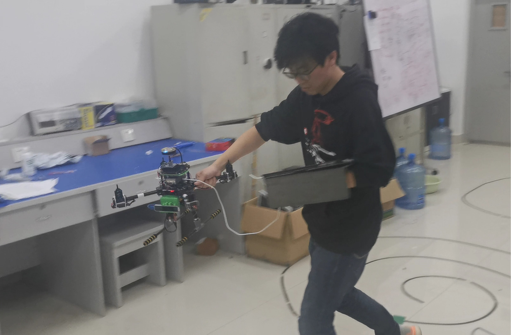
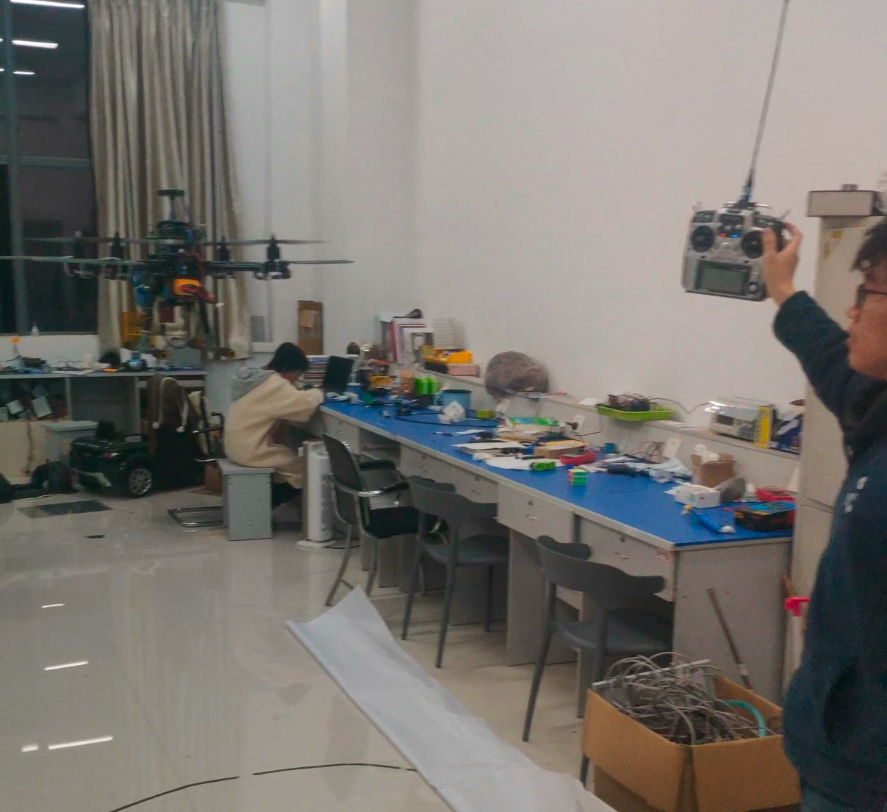
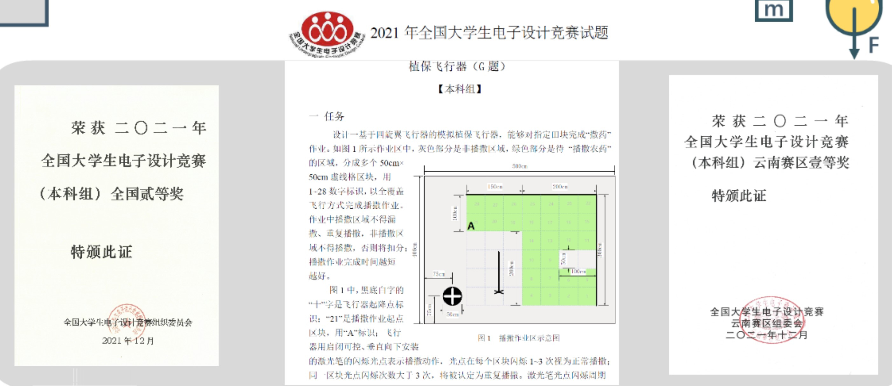

## 起点

高中时，我接触了飞控与多旋翼。

我了解了什么是 MultiWii，以及著名的 Ardupilot。

那时我一直在想，怎么把 MultiWii 复杂的代码跑进当时买得起的 Atmel 328p 里。

之后是跑在 Atmega2560 上的 Ardupilot。我调了整整一天。

然后是改版的 Pixhawk 2.4.8。

中间也做过一些奇怪的东西，比如靠第三轴拉力矢量舵机控制来抵消自旋的 Y3 机架。

还有轴距 1200 mm 的巨型八轴。

大学时，我再次和无人机结缘。这一次，我自己设计了 X4 四旋翼，拿到了 TI 杯全国二等奖——大学生电子设计竞赛的最高级别奖项。

这个项目最终成为我的毕业设计，并获得了优秀毕业论文。

