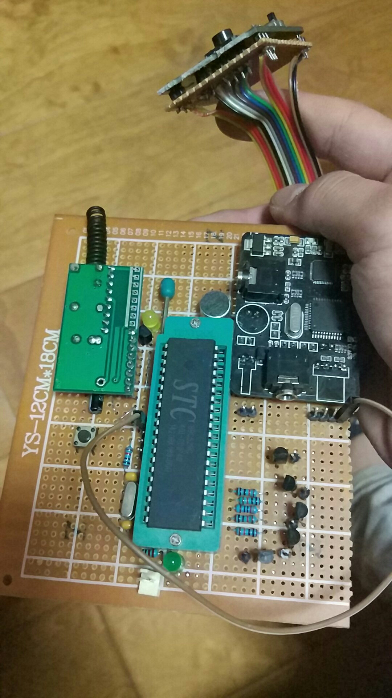
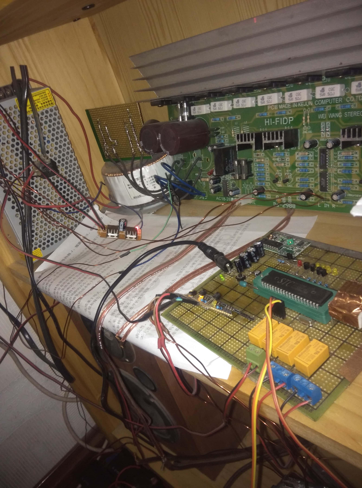
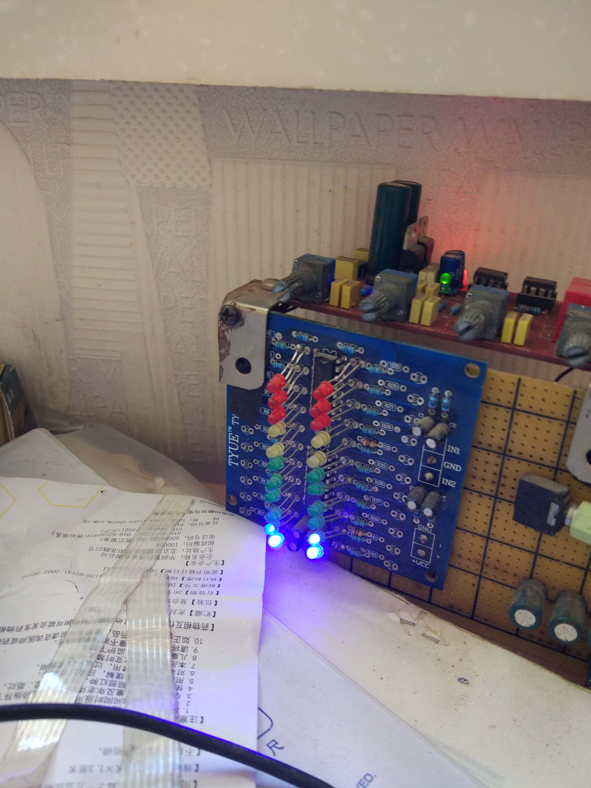
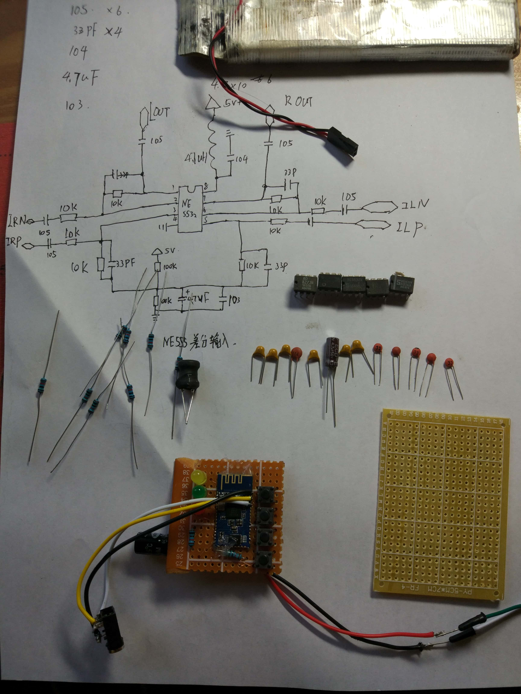
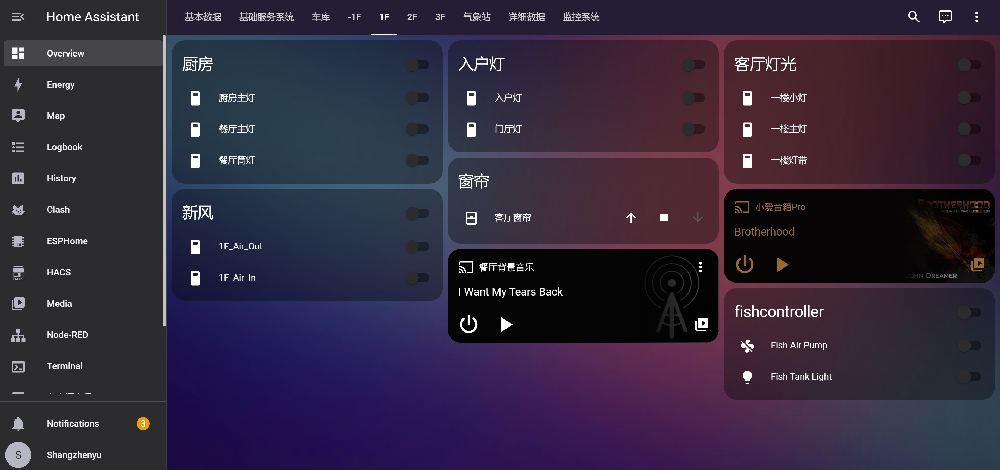
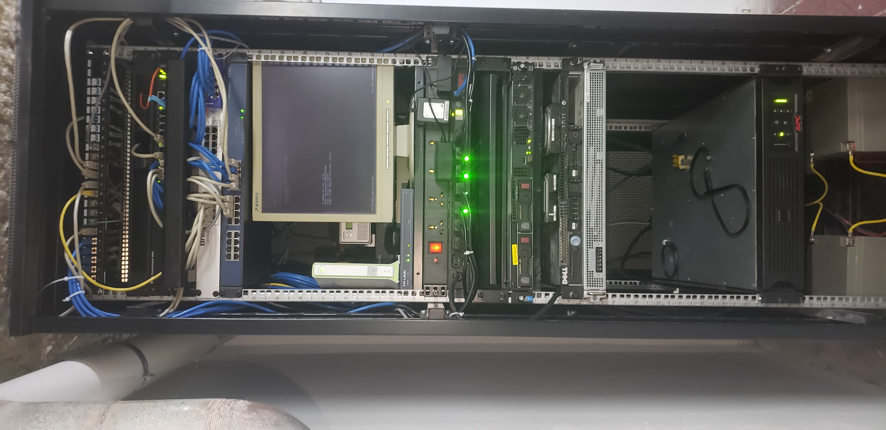
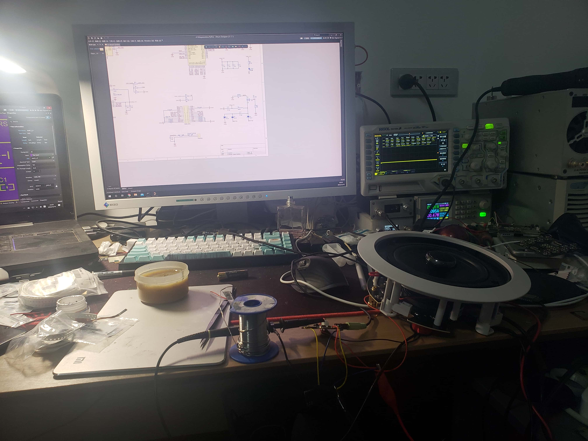

If you have to trace it back, this came from a middle-school love of Iron Man.

I wanted a Jarvis of my own.

## The prototype of Jarvis

The solution was STC8051 + LD3320.

The solution's judgment is based on Chinese pinyin, and the recognition is very inaccurate — but it satisfied the needs of junior-high-school me, who did not want to get out of bed to turn off the light on winter nights.

To make the system look less thin and boring, I added a Bluetooth audio system.

## Home Assistant

The second generation is based on Home Assistant, a Python-based hub system.

In the meantime, I moved to a new home. The garage holds a whole rack of servers.

On this server I ran the routing system and the smart home system. I then developed the voice input and output modules for the new system as well.

To be continued...
