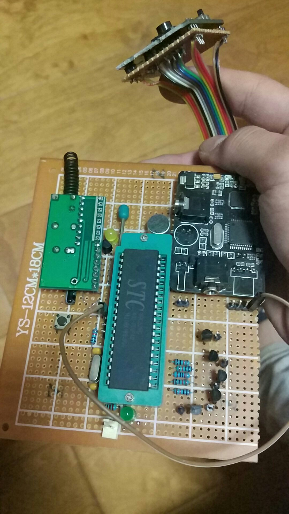
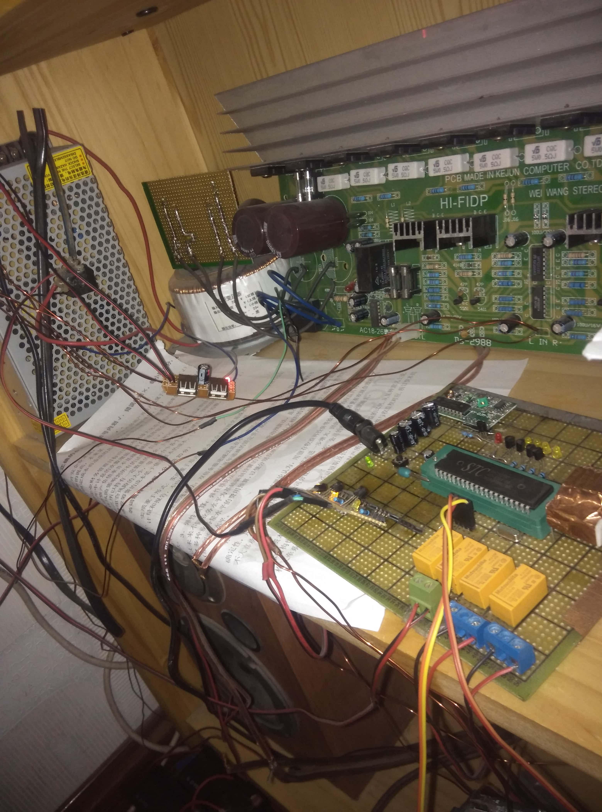
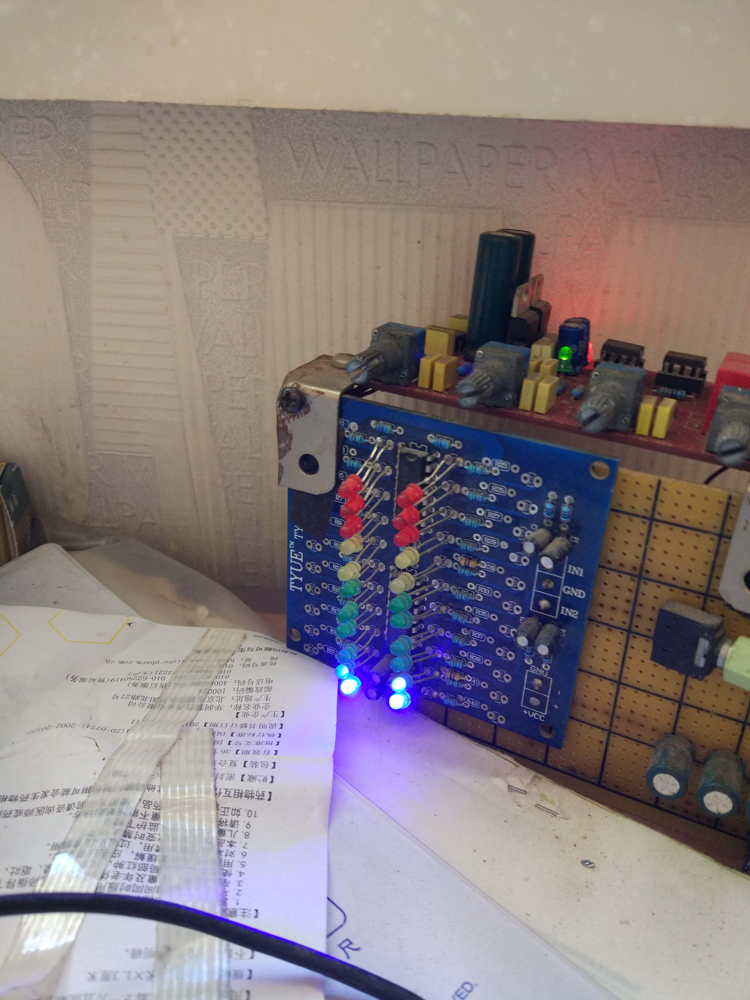
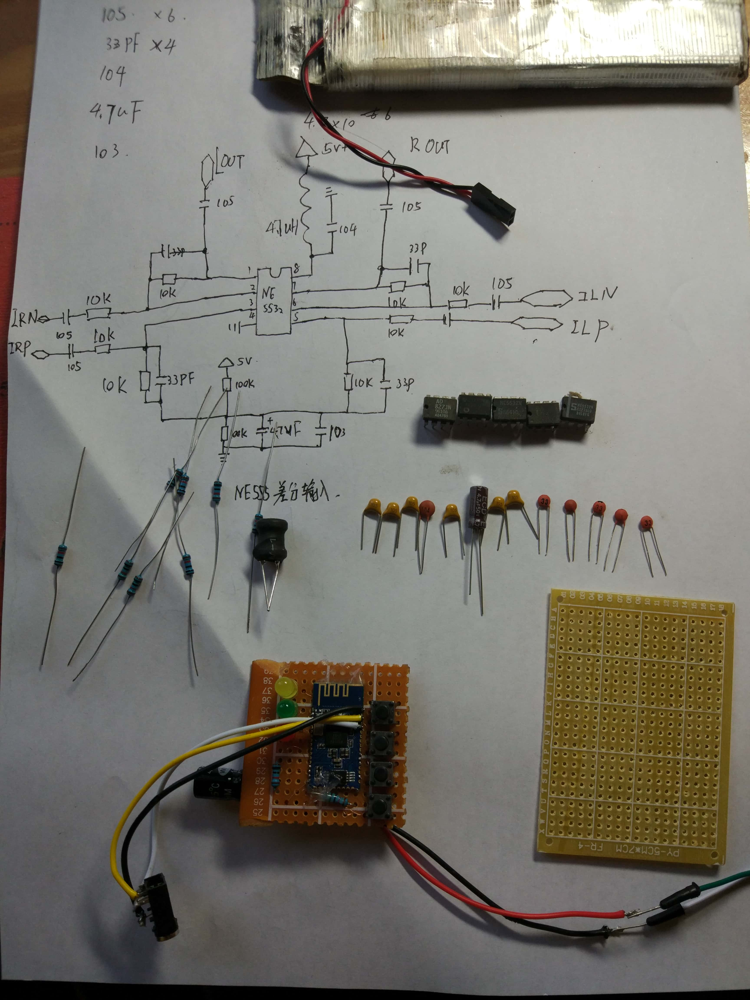
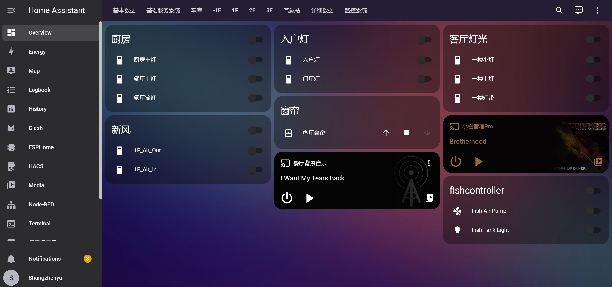
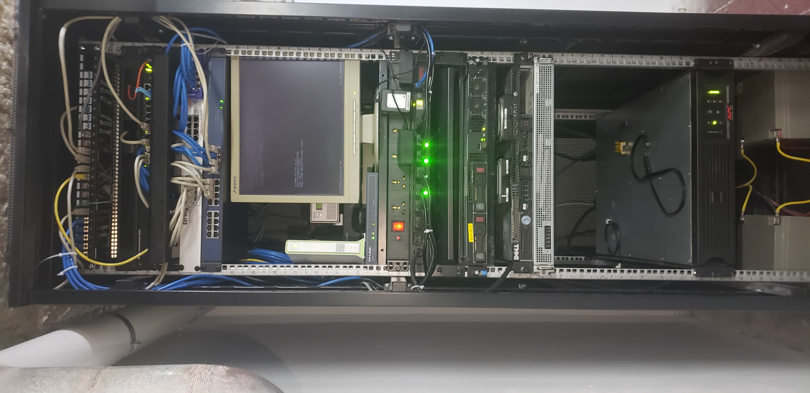
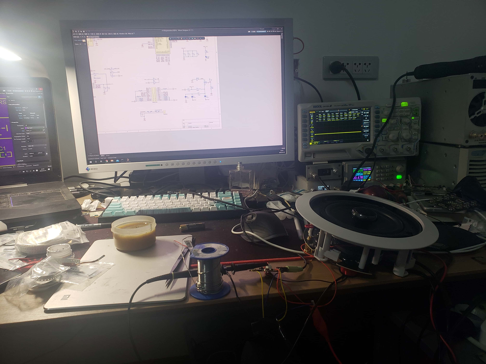

如果一定要追溯，这件事来自初中时对钢铁侠的喜爱。

我想要一个自己的 Jarvis。

## Jarvis 的原型

方案是 STC8051 + LD3320。

这套方案基于中文拼音做判断，识别很不准确，但它满足了初中时的我——一个冬夜不想下床关灯的人——的需求。

为了让系统看起来不那么单薄无聊，我加了一套蓝牙音频系统。

## Home Assistant

第二代基于 Home Assistant，一套 Python 的枢纽系统。

与此同时，我搬了新家。车库里放了一整机柜的服务器。

在这台服务器上，我跑了路由系统和智能家居系统。之后我也为新系统开发了语音输入输出模块。

未完待续……
